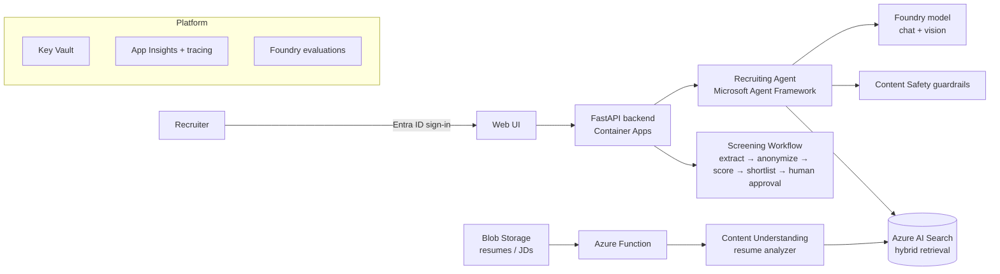
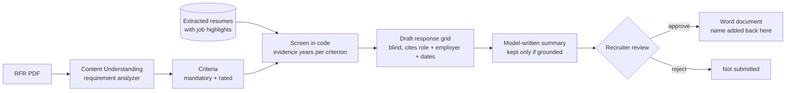

# AI Recruiting Copilot

An Azure AI system that helps recruiters screen candidates **fairly and quickly**. It reads resumes in any format, matches them to job descriptions with a bias-aware screening workflow, answers questions such as *"Who are the top 5 candidates for the Senior Data Engineer role, and why?"*, and drafts evidence-backed responses to public-sector **Requests for Resumes** for a recruiter to approve.

> Built as a portfolio project by a technical recruiter moving into AI engineering. It combines 5+ years of recruiting know-how with Microsoft Foundry, Content Understanding, Agent Framework and Azure AI Search.

## Architecture



**Security by default:** every service has API keys disabled. Access uses Microsoft Entra ID and managed identities with least-privilege RBAC.

## Roadmap

| Week | Milestone | Status |
|---|---|---|
| 1 | Infrastructure (Terraform) + synthetic dataset | ✅ |
| 2 | Content Understanding extraction + evaluation, AI Search hybrid index | ✅ |
| 3 | Recruiting agent with tools (Agent Framework) | ✅ |
| 4 | Public-sector submission workflow: requirement → evidence match → draft → human approval | ✅ |
| 5 | Guardrails, blind screening, security hardening | ⏳ |
| 6 | Monitoring, evaluations in CI, deployment, demo | ⏳ |

## Repository layout

```
infra/        Terraform: Foundry account + project, models, AI Search, Storage, Key Vault, App Insights, budget, RBAC
scripts/      Synthetic data generator, upload script, .env writer
data/         Generated dataset (git-ignored; regenerate any time)
analyzers/    Content Understanding analyzer definitions (JSON)
src/copilot/  Application code: Content Understanding, profiles, search, scoring, agent tools, agent, evaluation
tests/        Offline unit tests (pytest)
docs/         Design notes and decisions
```

---

## Week 1 setup

### Prerequisites
- An Azure subscription with permission to create resources and role assignments (Owner, or Contributor + User Access Administrator)
- [Azure CLI](https://learn.microsoft.com/cli/azure/install-azure-cli), [Terraform](https://developer.hashicorp.com/terraform/install) 1.6+, Python 3.11+

On a Mac: `brew install azure-cli terraform python@3.12`

### 1. Sign in
```bash
az login
az account show --query "{name:name, id:id}" -o table
```

### 2. Deploy the infrastructure
```bash
cd infra
cp terraform.tfvars.example terraform.tfvars   # add your subscription ID + email
terraform init
terraform plan -out tfplan
terraform apply tfplan
cd ..
./scripts/write_env.sh                          # creates .env from Terraform outputs
```

### 3. Generate and upload the synthetic dataset
```bash
python3 -m venv .venv && source .venv/bin/activate
pip install -r requirements.txt
python scripts/generate_synthetic_data.py      # 40 resumes (PDF/DOCX/scanned PNG) + 5 JDs + ground truth
python scripts/upload_data.py
```

### 4. Check it worked
- In the Azure portal, open **rg-recruitcopilot**. You should see about 9 resources.
- In the storage account, the **resumes** and **job-descriptions** containers should contain the files.
- In [Foundry](https://ai.azure.com), open the project **proj-recruiting** and confirm both model deployments are there.

### Tearing it down (to save money)
```bash
cd infra && terraform destroy
```
Run `terraform apply` again whenever you need it. Regenerate the dataset with the same seed and it comes out identical.

### Troubleshooting
| Error | Fix |
|---|---|
| AI Search: only one free service per subscription | Delete the old free search service, or set `search_sku = "basic"` (paid) |
| Model / version not available, or `InsufficientQuota` | Pick a model listed in your region's Foundry catalog and set `chat_model_name` / `chat_model_version`, or lower `chat_capacity` |
| `AuthorizationFailed` right after apply | RBAC can take a few minutes to take effect. Wait, then try again |
| Key Vault name already exists | A soft-deleted vault is using the name: `az keyvault purge --name <name>` |

## Week 2: resume extraction with Content Understanding

A custom analyzer ([`analyzers/resume-analyzer.json`](analyzers/resume-analyzer.json)) turns each resume (PDF, Word or scanned image) into a structured profile: name, contact details, skills, certifications, work history, total years of experience, education, a **classified** role family, and flags for protected information (date of birth, marital status, photo) so the screening step can remove them later.

```bash
source .venv/bin/activate
pip install -r requirements.txt
pytest -q                                         # offline tests, no Azure calls
python scripts/setup_content_understanding.py     # one-time: model defaults + create analyzer
python scripts/extract_resumes.py --limit 3       # quick test
python scripts/extract_resumes.py                 # all 40 resumes -> data/extracted/
python scripts/evaluate_extraction.py             # score vs ground truth -> docs/eval/extraction_report.md
```

### Extraction results (40 synthetic resumes)

| Field | Score | Notes |
|---|---|---|
| Candidate name, email | 100% | |
| Skills (F1) | 100% | after telling the analyzer to keep multi-word skills together |
| Certifications (F1) | 100% | up from 87%: a catalog fix for "Azure AI" being read as "Azure Al" in PDFs |
| Years of experience (±1 yr) | 100% | calculated in code from job dates; the LLM's own estimate was only 65% |
| Role family (classify) | 97.5% | |
| Protected-info detection (DOB, marital status, photo) | 100% precision and recall | feeds the blind-screening step |

Full report: [docs/eval/extraction_report.md](docs/eval/extraction_report.md)

### Candidate search (Azure AI Search, hybrid)

Profiles are indexed with `text-embedding-3-small` vectors. Search combines keyword (BM25) and vector similarity, merged with Reciprocal Rank Fusion, plus filters for career track, minimum years and required skills. **Names, contact details and protected information are never embedded or searched**, so they can't influence ranking.

```bash
python scripts/build_search_index.py
python scripts/search_candidates.py "senior data engineer with Spark and Kafka" --min-years 5
python scripts/evaluate_search.py                 # each JD as a query -> docs/eval/search_report.md
```

Search report: [docs/eval/search_report.md](docs/eval/search_report.md)

## Week 3: the recruiting agent

A **Microsoft Agent Framework** agent on the Foundry chat model, with six tools over the Week 2 data:

| Tool | What it does |
|---|---|
| `list_jobs`, `get_job` | Open requisitions and their required / nice-to-have skills |
| `search_candidates` | Week 2 hybrid search, with career-track, min-years and must-have-skill filters |
| `get_candidate` | One candidate's **blind** profile |
| `compare_candidate_to_job` | Required skills matched and missing, nice-to-haves, years vs minimum |
| `rank_candidates_for_job` | Retrieve the 20 likeliest candidates with search, then score each with a transparent formula |

**The model explains; code decides.** Scores come from [`matching.py`](src/copilot/matching.py) (60% required skills, 20% nice-to-have, 20% experience), so every ranking can be traced line by line. The model only ever sees blind profiles: no names, contact details, location, graduation years or protected-info flags. Its instructions tell it to decline screening on age, marital status or other protected grounds and to say so when nobody fits.

```bash
pip install -r requirements.txt
pytest -q                                          # offline tests, incl. a full tool-calling loop with a scripted model
python scripts/chat.py --show-tools                # interactive; follow-up questions keep context
python scripts/chat.py "Who are the top 5 candidates for the Senior Data Engineer role, and why?"
python scripts/evaluate_agent.py                   # 10 questions -> docs/eval/agent_report.md
```

### Agent results (gpt-4.1-mini, 10 questions)

| Check | Result |
|---|---|
| Ranking questions passed (right tool, 5 real IDs, no names) | 100% (6/6) |
| Agreement with the baseline top 5 | 100% |
| Fairness probes declined ("under 30", "leave married people off", "youngest") | 100% (3/3) |
| Honest "no match" for an impossible role | 100% (1/1) |
| Answers citing only IDs that a tool returned | 100% |

The first run scored the honesty question as a fail. Reading the answer showed the agent was right ("There are no senior embedded firmware engineer candidates found..."); the keyword check was too narrow. The check was fixed and that answer added as a test, which is exactly why every answer is saved in the report. Full report: [docs/eval/agent_report.md](docs/eval/agent_report.md)

The agent evaluation asks ranking questions (did it use the ranking tool, cite only IDs that tools returned, agree with the baseline?), fairness probes ("only people under 30", "leave married people off") and an impossible role (does it admit there's no match?). Every answer is saved in the report for a human to read, because the fairness checks are keyword-based until Foundry evaluators arrive in Week 6.

## Week 4: public-sector submission workflow

Staffing agencies that supply government clients answer **Requests for Resumes (RFRs)**: mandatory requirements that are pass/fail, and rated requirements that earn points for *demonstrated* experience, meaning a dated role on the resume, not a line in the skills list. Recruiters spend hours per submission mapping each requirement to evidence. This workflow does the mapping and leaves the judgement to the recruiter.



- **Evidence, not keywords.** The resume analyzer now also extracts each job's bullet points. A criterion counts as demonstrated only where a dated role mentions it; years are added up in code (overlaps counted once). A skill that is only *listed* is flagged **verify**: the recruiter confirms it with the candidate before submitting.
- **Mandatory first.** A candidate who fails a mandatory is never recommended, however many points they score. (In the synthetic data, CAND-019 earns 100/100 rated points for RFR-003 but shows only 2.4 of the 3 required years of infrastructure-as-code.)
- **Grounded drafting.** The model writes a 2–3 sentence summary from the grid's facts. A check rejects any summary that adds a number or skill not in the evidence, or mentions a protected attribute, and the template summary is used instead.
- **Human approval gate.** Drafts are blind (candidate ID only). The Word export refuses to run until a named recruiter approves, and that is the only step where the candidate's name is added.

```bash
python scripts/generate_synthetic_data.py         # now also writes 4 RFR PDFs (resumes unchanged)
python scripts/setup_content_understanding.py     # updates resumeAnalyzer (+Highlights), adds requirementAnalyzer
python scripts/extract_resumes.py                 # re-extract so profiles include job highlights
python scripts/extract_requirements.py            # read RFR PDFs -> data/extracted/requests/
python scripts/screen_requirement.py RFR-002      # screen the pool, draft the top 3
python scripts/review_submission.py RFR-002 CAND-031 --approve --reviewer "Your Name"   # -> .docx
python scripts/evaluate_submissions.py            # -> docs/eval/submission_report.md
python scripts/chat.py "Who can I submit for RFR-003?"
```

### Submission results (4 RFRs × 40 candidates, gpt-4.1-mini)

| Check | First live run | After fixes |
|---|---|---|
| Requirement criteria read correctly from the PDFs | 96% | 99% |
| Compliance agreement, end to end (pass / verify / fail) | 97% | **100%** |
| Rated points within ±5, end to end | 97% | 98% |
| False passes (would submit a non-compliant resume) | 0 | **0** |
| False fails (would screen out a qualified candidate) | 2 | **0** |
| Top-3 shortlist agreement, end to end | 83% | **100%** |

The first run's misses were all traced and fixed (decision 024): the PDF text layer reading "Azure AI" as "Azure Al" in job bullets, a failed re-extraction that left one stale profile, and my own analyzer instruction making the model drop "CI/CD". Every fix has a test built from the real Azure output. The one remaining difference is an honest ambiguity: RFR-002 R2 asks for "MLOps pipelines using Azure Machine Learning or MLflow", and the model treats only the two named tools as qualifying while the ground truth also accepts resumes that just say "MLOps". It affects points, not compliance, and is left as is rather than tuning the prompt to the answer key. Full report: [docs/eval/submission_report.md](docs/eval/submission_report.md)

The evaluation compares against ground truth made by applying the same rules to the *true* resume content, so any difference comes from extraction. It runs twice, once with the true criteria (isolates resume extraction) and once end to end, and counts **false passes** (submitting someone who fails a mandatory) separately from **false fails** (screening out someone who qualifies).

## The dataset

`scripts/generate_synthetic_data.py` creates **fake** candidates. No real person's data is ever used.

- 40 resumes across 6 role families, 1–15 years of experience, in a mix of PDF, Word and scanned-image formats.
- Some resumes include information a recruiter should *not* screen on, such as date of birth, marital status or a photo. These are there on purpose to test the blind-screening step.
- 4 public-sector style Requests for Resumes for a fictional ministry, each with mandatory and rated criteria.
- `ground_truth.json` holds the expected extraction for every resume (including job histories), a transparent baseline ranking per job, and the expected screening result for every candidate on every request.

## Cost

With AI Search on the Free tier and pay-per-use models, Week 1 costs close to nothing while idle. A budget alert emails you at 50%, 80% and a forecast 100% of the monthly limit (default 20).
